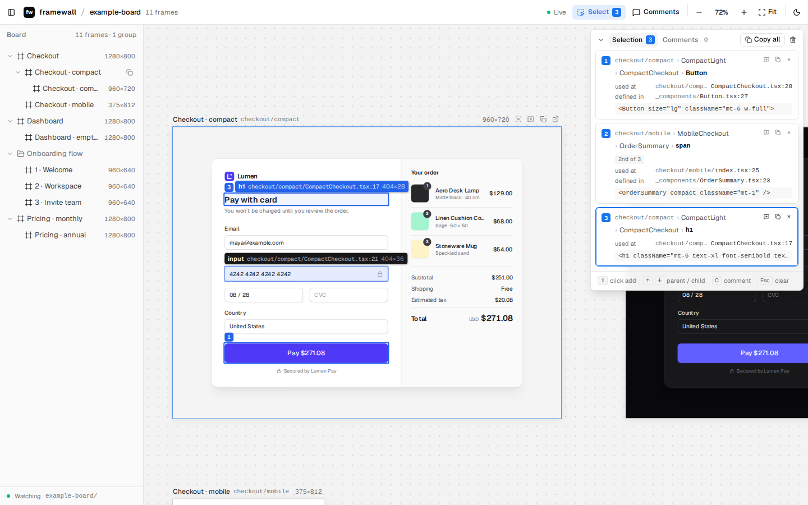

# framewall

A code-first UI prototyping canvas: Storybook crossed with Figma. A **board** is a folder on disk,
and every **frame** in it is a live React page rendered in an iframe on an infinite canvas. You edit
the code in any editor (or let a coding agent do it) and the canvas updates as you save. Code on
disk is the only source of truth; there is no database, no graph and no saved layout.

Pick elements on the canvas, comment on them, and hand the comments to an agent as one-line
references that point at the exact file and line.



> **Status:** early prototype. It runs from a clone of this repo as a Vite dev server and isn't
> published to npm.

## Quick start

Needs Node 22.18 or later.

```sh
git clone https://github.com/turboznik/framewall.git
cd framewall
npm install
npm run dev                         # http://127.0.0.1:5173, shows example-board/
BOARD_DIR=~/some/board npm run dev  # any folder (absolute, or relative to the repo)
```

## Concepts

| Term        | On disk                                       | On the canvas                              |
| ----------- | --------------------------------------------- | ------------------------------------------ |
| **board**   | a directory (`BOARD_DIR`, default `example-board/`) | the whole canvas                     |
| **frame**   | a folder with an `index.tsx` that default-exports a component | a live iframe at its own size |
| **group**   | a folder without `index.tsx`                  | a labeled section around its children      |
| **element** | a JSX element in a board file (`file:line`)   | a DOM node in a frame, picked in select mode |

- A frame's **ID** is its path relative to the board, e.g. `checkout/compact/dark`.
  `/frame/<id>` renders that frame alone, full page.
- Nesting means "belongs under": `checkout/mobile/` is a variant of `checkout/`.
- An optional `frame.json` sets `{ "width": 375, "height": 812, "title": "Checkout · mobile" }`.
  The default size is 1280×800. Groups may have a `frame.json` with just a `title`.
- Folders starting with `_` or `.` are ignored. Put shared code in `_components/` (or `_shared/`
  inside a group) and import it with relative paths.
- Frames get Tailwind v4 (the board folder is scanned), Geist and Geist Mono, and their own CSS,
  isolated from the canvas UI. Use the `dark` class on a wrapper for dark variants.

## Using the canvas

- **Pan:** drag the background, scroll, or two-finger swipe. **Zoom:** ctrl/cmd + scroll, pinch,
  `+` / `-`, the top bar controls. `Shift+1` fits everything, `Shift+2` the selection, `Shift+0`
  is 100%.
- **Select:** click a frame or its label. `Esc` deselects. A selected frame takes pointer input,
  so you can click around inside it.
- **Zoom to a frame:** the label's **Zoom to frame** button, a double-click on the frame or its
  label, `Shift+2` (the selected frame), or a click on a tree item. It selects the frame and
  animates to fit all of it, label included, in the part of the canvas the side panel (or the
  phone sheet) leaves free, with padding, never past 100%.
- **Frame actions** (label, top bar, or hover a frame in the tree): zoom to frame (label only),
  comment, copy reference, open `/frame/<id>` in a new tab. On narrow labels (low zoom) only
  Zoom to frame stays.
- **Select elements:** press `S` (or **Select** in the top bar). Hovering inside any frame outlines
  the element with its component and `file:line`; click selects it, `Shift`+click adds more (across
  frames too), `↑` / `↓` move to the parent / child (`←` / `→` to siblings). The panel's
  **Selection** tab shows each element with its component breadcrumb (click a crumb to select that
  level), where it's used and defined, and Comment / Copy reference / Remove. Dragging inside a
  frame still pans. `Esc` clears the selection, a second `Esc` leaves select mode. The selection
  is saved to `BOARD_DIR/.framewall/selection.json` and survives reloads.
- **References.** Everything copies the same one-line tag (see "For agents"): **Copy reference**
  on a frame label, a tree row or a selected element, **Copy all** for the whole selection, and
  `⌘⇧C` / `Ctrl+Shift+C` for the current selection (elements if you picked last, else the frame).
- **Comments.** Select an element, or a frame (click its label), and press `C` (or **Comment**).
  The composer opens in the panel's **Comments** tab. Type `@` to insert a frame (by ID or title)
  or a selected element as a chip, or paste a copied tag (other text pastes as plain text).
  Hovering a chip outlines its target, clicking it moves the canvas there. `⌘↵` / `Ctrl+Enter`
  adds the comment, `Esc` cancels; comments can be edited and deleted (with undo). Each comment
  gets a numbered pin on its element or by its frame's corner (click it to open the comment);
  pins follow layout changes and hot updates. If an element can't be found after an edit, or its
  frame is deleted, the comment is kept and marked **stale** (no pin). The **Comments** button in
  the top bar (with the count) opens the list; **Copy all** copies the buffer for an agent,
  **Clear** empties it (with undo). The buffer is saved to `BOARD_DIR/.framewall/comments.json`.
- Layout is automatic: top-level items stack in a column, a frame's children stack to its right,
  a group lays its children out in a row.


## For agents

- **Frames** are folders under the board (`example-board/` here, or `$BOARD_DIR`) with an
  `index.tsx`; the frame ID is the folder path, e.g. `checkout/compact`. Shared code is in `_`
  folders such as `_components/`. Edit the files; the canvas hot-reloads.
- **Screenshot a frame** at `http://127.0.0.1:5173/frame/<id>` (e.g. `/frame/checkout/compact`),
  at the size in its `frame.json` (default 1280×800).
- **References** are one-line tags, the same wherever they come from (copy buttons, the CLI, the
  comment export):

  ```
  <frame id="checkout/mobile" />
  <element frame="checkout/compact" path="CompactCheckout › Button" at="checkout/compact/CompactCheckout.tsx:28" defined-in="_components/Button.tsx:27" />
  ```

  `at` is where the element is written in the frame's own files (board-relative `file:line`),
  usually what to edit. `defined-in` is where the DOM element itself is written, present only
  when it differs (a shared component). `path` is the end of the component breadcrumb.
  `instance="2"` means the second of several renders of the same JSX (a list). Attribute values
  are XML-escaped.
- **The user's comments:** `bin/framewall comments` (run from this repo) prints the comment
  buffer, no browser needed:

  ```
  <framewall board="/path/to/framewall/example-board">
    <comment element="CompactCheckout › Button" frame="checkout/compact" at="checkout/compact/CompactCheckout.tsx:28" defined-in="_components/Button.tsx:27">
      Make this the primary action &amp; keep the size
    </comment>
    <comment frame="checkout/mobile">
      Match the spacing of <frame id="checkout/compact" />
    </comment>
  </framewall>
  ```

  Each `<comment>` names its target with the reference attributes; the text is XML-escaped, with
  inline references as tags. `stale="true"` means the target wasn't found after the last edit
  (or the frame is gone): the locations are the last known ones. `--json` prints the raw file,
  `--clear` empties the buffer (the canvas follows), `--board <dir>` picks another board.
- **What the user picked:** `bin/framewall selection` prints one reference tag per selected
  element (`stale="true"` when it wasn't found after the last edit); `--json` prints the raw file
  with snippets and full breadcrumbs. The canvas keeps line numbers current as files change.
- The same data is at `GET /__framewall/comments` and `GET /__framewall/selection`
  (`?format=text` for the tags).

## Configuration

Environment variables for `npm run dev`:

| Variable          | Default         | Meaning                                                              |
| ----------------- | --------------- | -------------------------------------------------------------------- |
| `BOARD_DIR`       | `example-board` | the board folder, absolute or relative to the repo                   |
| `PORT`            | `5173`          | the port (the server won't start if it's taken)                      |
| `ALLOWED_HOSTS`   | none            | extra host names to answer to, comma-separated (`.example.com` covers its subdomains) |
| `HMR_CLIENT_PORT` | the same port   | the port the browser opens the HMR websocket on                      |

framewall *is* the dev server: live editing is the product, so there is no production build to
deploy. It listens on 127.0.0.1 only. To reach it from another machine, put an HTTPS reverse
proxy in front, add the proxy's host name to `ALLOWED_HOSTS`, and set `HMR_CLIENT_PORT` to the
port the proxy listens on.

The server can read your source files and write the board's `.framewall/` folder. Its board API
refuses requests from other sites (an unknown `Host`, cross-origin or non-JSON writes), but keep
it on a trusted network all the same.

## Development

```sh
npm test                            # vitest: scanning, layout, stamping, reference tags, comments, API guard
npm run typecheck && npm run lint
```

The end-to-end checks drive a running dev server with Playwright (`npx playwright install chromium`
once). The ones that edit `example-board/` restore it when they finish.

```sh
node scripts/smoke.mjs              # screenshots: desktop and phone, light and dark
node scripts/live.mjs               # live updates: edits, new and renamed folders, errors
node scripts/pick.mjs               # element picking
node scripts/comments.mjs           # comments
```

`BASE` points them at another server (default `http://127.0.0.1:5173`); screenshots go to `shots/`.

## How it works

One Vite dev server serves both the canvas (`index.html` → `src/main.tsx`) and the frames
(`frame.html` → `src/frame/main.tsx`, which `/frame/*` page requests are rewritten to).

- **The board tree.** `plugins/framewall.ts` scans `BOARD_DIR` (`plugins/scan.ts`) and serves it
  as `virtual:framewall/tree`. It listens to Vite's own file watcher (`server.watcher`, native
  events, no polling); adding, removing or renaming a folder, or editing a `frame.json`, rescans
  (debounced 40 ms) and pushes the new tree over the HMR websocket as a custom event. The canvas
  swaps its tree in place, without a reload. A client that connects late asks for the current tree.
- **Frames.** `src/frame/registry.ts` maps every `index.tsx` on the board to a lazy loader with
  `import.meta.glob`. Each iframe loads only its own module. Edits to a frame or to `_components`
  are ordinary HMR and React Fast Refresh inside the affected iframes. The frame entry accepts
  updates to the registry, so frames appearing or disappearing never escalate to a full reload
  (which Vite would send to the canvas too).
- **Errors stay in their frame.** Vite's overlay is off, because it would show on every page.
  Each frame tracks the HMR errors that concern the modules it loaded (`src/frame/build-errors.ts`),
  catches render errors in an error boundary, retries failed imports under a fresh URL, and shows
  its own error panel. It reports `ready` / `error` / `missing` to the canvas over `postMessage`,
  and recovers on the next good save.
- **Tailwind for frames.** `src/frame/frame.css` uses `source(none)` plus an `@source` for the
  board folder, injected by the plugin. Tailwind only re-scans when that CSS is rebuilt, so the
  plugin reloads it when files are added.
- **Stale modules.** Vite keeps module nodes for deleted files; when a file comes back at the
  same path, the orphan node would trigger a full page reload. The plugin's `hotUpdate` hook
  drops board modules nobody imports.
- **Canvas.** Plain CSS transforms (no canvas library). The camera is applied to the DOM outside
  React; labels and outlines are counter-scaled with a `--z` variable so they stay crisp. Frames
  render in a stable DOM order, because moving an iframe in the DOM reloads it. Iframes forward
  ctrl/cmd + wheel (zoom), wheel they can't use (pan) and `Esc` to the canvas.
- **Element picking.** In dev, `plugins/stamp.ts` (a pre-transform using `@babel/parser` and
  `magic-string`, with a source map) adds `data-fw-src="<path>:<line>:<col>"` to every JSX element
  in board files, on the same line, after the other attributes. The frame runtime
  (`src/frame/picker.ts`) reads the stamps from React fibers (`__reactFiber$…`, walking `return` up
  to the frame's error boundary): host elements give "defined in", the nearest stamp in the frame's
  own files gives "used at", stamped components give the breadcrumb. It draws hover and selection
  outlines in a shadow-DOM overlay (counter-scaled by the canvas zoom), takes over pointer input
  in select mode (a drag is forwarded as a pan), and re-finds selections after hot updates by stamp
  and position, else by file, tag and component; what it can't find is reported as stale. The
  canvas owns the selection (`src/board/pick-store.ts`) and saves it through
  `/__framewall/selection` (`plugins/selection.ts`, which also adds the snippets) to
  `BOARD_DIR/.framewall/`, a folder Vite's watcher and Tailwind ignore, so saving reloads nothing.
- **References and comments.** `shared/refs.ts` formats and parses the reference tags (one
  formatter for the copy buttons, the CLI and the export); `shared/comments.ts` has the buffer
  format and the XML export. The canvas keeps the buffer (`src/board/comment-store.ts`) and saves
  it through `/__framewall/comments` (`plugins/comments.ts`) to `.framewall/comments.json`; the
  server broadcasts each write (and changes made by the CLI, seen with `fs.watch`) over the HMR
  websocket, tagged with the writer's client ID so other canvases follow. Every element a comment
  points at (its target and its inline chips) is a **track**: the canvas sends each frame its
  tracks, the picker resolves them (by key, or by `at` / `defined-in` / `instance` for a pasted
  tag), reports updated references or stale, and reports pin rectangles when they change; the
  canvas draws the pins in its world layer, next to the frames. A deleted frame makes its comments
  stale on the canvas side. `bin/framewall` reads the files with Node's type stripping and the
  shared formatters.


```
bin/framewall   the CLI (`framewall selection`, `framewall comments`)
plugins/        Vite plugin (watcher, virtual modules, /frame rewrite), folder scanner,
                JSX stamping, selection and comments endpoints, API guard
shared/         types and helpers used by Node and the browser (board, selection, reference
                tags, comments + export)
src/board/      tree store, frame selection, element selection, comment buffer, layout
src/canvas/     camera, Canvas, FrameCard, GroupSection, comment pins
src/components/ sidebar tree, top bar, side panel (selection, comments, composer), shadcn/ui
src/frame/      the frame runtime (entry, registry, error handling, canvas bridge, element picker)
example-board/  the sample board ("Lumen", a fictional shop): 11 frames
scripts/        end-to-end checks (Playwright)
```

## Out of scope (for now)

An MCP server, fork buttons, code editing in the browser, comment threads or resolving (the
buffer is a hand-off list for an agent), and iframe virtualization (every frame is a live iframe,
so very large boards get heavy).

## License

[MIT](LICENSE)
